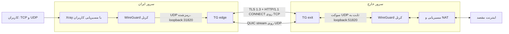
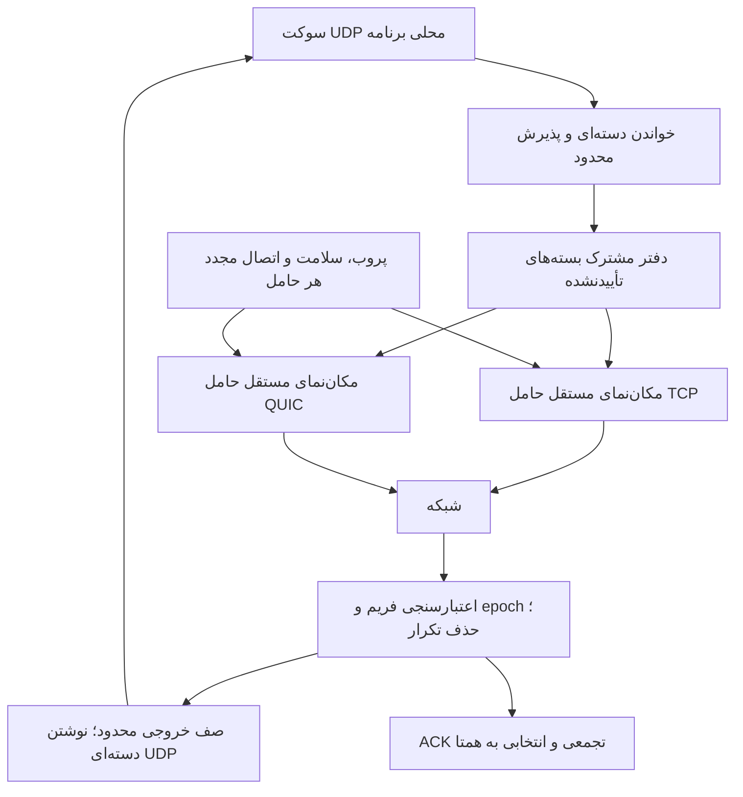

# TG — تانل اختصاصی بین سرور ایران و خارج

**سند معرفی مدیریتی و فنی • نسخهٔ توسعهٔ ۰٫۱ • به‌روزرسانی: ۲۰۲۶/۱۰/۲۴**

[English](README.md) · [نصب تک‌خطی، دو سرور و Xray/X-UI](docs/deployment-fa.md) · [گزارش آزمون اخیر](docs/one-gig-fa.md) · [داده‌های آزمون](docs/one-gig-results.json)

## خلاصهٔ مدیریتی

TG برای حمل ترافیک کاربران میان سرور ایران و سرور خارج طراحی شده است. یک لایهٔ نشست اختصاصی، بسته‌های UDP را روی حامل‌های رمز‌شدهٔ TCP و UDP جابه‌جا می‌کند. در کاربرد اصلی، **WireGuard کرنل لینوکس** بسته‌های IP کاربران را رمز می‌کند و TG بسته‌های WireGuard را حمل می‌کند؛ بنابراین هر دو نوع ترافیک TCP و UDP کاربران قابل حمل‌اند.

ارزش اختصاصی پروژه در مدیریت نشست مشترک میان حامل‌ها، نگه‌داری محدود بسته‌های تأییدنشده، بازپخش پس از اتصال مجدد، حذف تکرار، کنترل مصرف حافظه و پایش است. رمزنگاری به استانداردهای موجود تکیه دارد؛ الگوریتم رمزنگاری یا خود WireGuard دوباره اختراع نشده است.

**وضعیت فعلی: نمونهٔ اجرایی و آزموده‌شده در آزمایشگاه؛ پذیرش عملیاتی هنوز کامل نیست.** آزمون اخیر ۳۰ دقیقه‌ای، میانگین دریافت ۱٫۰۵ گیگابیت داشت، اما کف سرعت و کیفیت تأخیر زیر بار، شرط «حدود یک گیگابیت پیوسته و مناسب بازی» را پاس نکردند. رشد حافظهٔ خود TG در این آزمون کنترل‌شده بود. مسیر واقعی ایران به خارج هنوز آزموده نشده است.

| موضوع | هدف و وضعیت قابل ارائه |
|---|---|
| کاربرد | اتصال ایران به خارج و حمل ترافیک تجمیعی چند کاربر |
| هدف جاری | حدود **۱ Gbit/s تجمیعی** با تأخیر و نوسان پایین؛ پذیرش کامل هنوز رد است |
| مرحلهٔ اولیه | کف ۳۰۰ Mbit/s در برخی پروفایل‌های محلی قبلی پاس شد؛ نتیجهٔ هر پروفایل مستقل است |
| هدف ظرفیت نهایی | **۱۰ Gbit/s تجمیعی**؛ محقق و تأیید نشده است |
| تحمل خرابی | اتصال مجدد و بازیابی نشست با حفظ سوکت برنامه هنگام تعویض حامل؛ بدون تضمین اتلاف صفر |
| محیط تأییدشده | آزمایشگاه با WireGuard واقعی کرنل؛ نه اینترنت ایران و نه کارکرد ۲۴ساعته |
| تصمیم پیشنهادی | رفع افت زیر بار، سپس پایلوت محدود روی دو سرور واقعی؛ تعهد SLA تولید پس از پذیرش |

واحدها: `۱ Gbit/s = ۱۰۰۰ Mbit/s ≈ ۱۲۵ MB/s`. درخواست پیشین «۱ GB/s» تقریباً `۸ Gbit/s` است و با هدف جاری یک گیگابیت تفاوت دارد. اعداد سرعت این سند نرخ مفید **دریافتی** هستند، مگر آنکه صریحاً نرخ ورودی یا حامل ذکر شود.

## فهرست

- [معماری و شماتیک](#architecture)
- [حامل‌ها و پروتکل‌ها](#protocols)
- [نشست، تأیید و بازیابی](#reliability)
- [ساختار فریم](#framing)
- [کنترل CPU و حافظه](#resources)
- [شواهد سرعت، تأخیر و قطع مسیر](#evidence)
- [امنیت و محدودیت‌های شبکه](#security)
- [نصب، بهره‌برداری و پایش](#operations)
- [نقشهٔ پذیرش و توسعه](#roadmap)
- [مستندات و ارجاع به کد](#references)

<a id="architecture"></a>
## ۱. معماری و شماتیک

### مسیر کامل ترافیک



شکل بالا پروفایل صریح **CONNECT + QUIC-stream** را نشان می‌دهد. تنظیم اولیهٔ `tg init` از **HTTPS/2 + QUIC-stream** استفاده می‌کند؛ CONNECT نیازمند تغییر هماهنگ دو سر است.

TG یک جفت همتای UDP برنامه را حمل می‌کند. چند کاربر داخل همان تونل IP قابل حمل‌اند؛ چند فرستندهٔ UDP نامرتبط نباید مستقیماً یک ورودی edge را شریک شوند، چون پاسخ به آخرین فرستندهٔ محلی برمی‌گردد. ساخت WireGuard، افزودن کاربر، مسیریابی، NAT و احراز هویت کاربران وظیفهٔ لایهٔ استقرار یا پنل است.

### اجزای داخل هر پردازش TG



این نمودار برای `redundant: true` با حامل‌های قابل‌اعتماد است. هر دو جهت دفتر ارسال و مسیر دریافت خود را دارند؛ ACK همتا، بستهٔ تأییدشده را از دفتر ارسال محلی آزاد می‌کند.

<a id="protocols"></a>
## ۲. حامل‌ها و پروتکل‌ها

| لایه یا حامل | سازوکار واقعی | کاربرد و محدودیت |
|---|---|---|
| WireGuard داخلی | رابط IP رمز‌شده در کرنل، با کلیدهای مستقل از TG | حمل TCP/UDP کاربران؛ تنظیم جداگانه |
| `https-connect` | TLS 1.3، گواهی متقابل، توکن و HTTP/1.1 CONNECT؛ سپس فریم TG | حامل صریح TCP؛ پراکسی میانی باید CONNECT دوطرفه را پشتیبانی کند |
| `https` | TLS 1.3 و جریان دوطرفهٔ HTTPS/2؛ اعتبارسنجی سرور و توکن | حامل TCP پیش‌فرض مولد؛ احراز هویت آن با mTLS حامل CONNECT یکسان نیست |
| `quic-stream` | QUIC با گواهی متقابل و یک جریان دوطرفهٔ قابل‌اعتماد | حامل UDP پیش‌فرض؛ بازفرست و کنترل ازدحام در QUIC |
| `quic` | QUIC DATAGRAM؛ در افزونگی، تعمیر انتخابی در لایهٔ نشست | آزمایشی؛ پروفایل پذیرفته‌شدهٔ پایداری نیست |

TCP و QUIC-stream تحویل مرتب بایت‌ها را در اتصال خود فراهم می‌کنند. اتلاف می‌تواند داده‌های بعدی همان جریان را عقب بیندازد؛ این **Head-of-Line blocking** در جیتر اهمیت دارد. قرار دادن TCP کاربران در حامل TCP، اثر بازفرست و ازدحام دو لایه را حذف نمی‌کند.

### مذاکره و سازگاری

- نسخهٔ فریم TG برابر `1` است. نوع حامل، حالت نشست و سقف بسته باید در دو سر سازگار باشند.
- ALPN حالت عادی QUIC-stream برابر `tg-stream-v1` و حالت افزونگیِ قطعه‌ای برابر `tg-repair-v1` است.
- حالت بستهٔ کامل با سقف ۲۰۴۸، شناسهٔ `packet-repair-v2-2048` دارد؛ ALPN متناظر QUIC برابر `tg-packet-repair-v2-2048` است.
- CONNECT از ALPN برابر `http/1.1` و هدرهای `X-Tg-Session`، `X-Tg-Path`، `X-Tg-Epoch` و `X-Tg-Mode` استفاده می‌کند. پاسخ موفق هم باید epoch و حالت سازگار داشته باشد.
- تغییر HTTPS/2 به CONNECT خودکار نیست. یک CDN عمومی یا reverse proxy معمولی الزاماً این مسیر را عبور نمی‌دهد.

<a id="reliability"></a>
## ۳. نشست، تأیید و بازیابی

با `redundant: true`، بستهٔ پذیرفته‌شده شناسه می‌گیرد و در دفتر مشترک محدود می‌ماند. هر حامل مکان‌نمای مستقلی دارد و قدیمی‌ترین بسته‌های تأییدنشده را به ترتیب همان حامل می‌فرستد. خرابی اتصال، بازپخش بسته‌های باقی‌مانده را پس از اتصال مجدد ممکن می‌کند.

حامل سالم با هزینهٔ تنظیم‌شدهٔ کمتر زودتر ارسال می‌کند. پشتیبان به‌صورت پیش‌فرض **۱۰ میلی‌ثانیه** فرصت رسیدن ACK می‌دهد و بستهٔ تأییدشده را دوباره نمی‌فرستد. بازهٔ `replica_delay_ms` صفر تا ۵۰ است. مقدار صفر، نسخه‌ها را فوری می‌فرستد و می‌تواند پهنای باند و CPU بیشتری مصرف کند. اگر RTT تأیید از مهلت بلندتر باشد، حالت تأخیری نیز ممکن است هر دو نسخه را بفرستد.

گیرنده بسته‌های کامل تکراری را حذف می‌کند. پیش‌فرض، تحویل مستقل از شناسه‌های گم‌شدهٔ دیگر است. `ordered_output: true` ترتیب سراسری را فعال می‌کند؛ عقب‌افتادن یک بسته در آن می‌تواند جریان‌های دیگر را نیز منتظر نگه دارد.

**معنای ACK:** تکمیل دریافت و بازسازی در TG همتا؛ نه رسیدن قطعی به WireGuard یا برنامهٔ نهایی کاربر. پذیرش باید با گیرندهٔ نهایی سنجیده شود.

| رخداد | رفتار پیاده‌شده | محدودیت |
|---|---|---|
| خرابی TCP با UDP سالم | ادامه یا بازپخش از QUIC و تلاش مستقل اتصال مجدد TCP | کف سرعت و تأخیر زیر بار همچنان باید پاس شوند |
| خرابی UDP با TCP سالم | استفاده از TCP و ادامهٔ پروب‌ها | TCP نیز محدودیت ظرفیت و تأخیر دارد |
| قطع هر دو حامل | توقف تحویل؛ نگه‌داری در بودجهٔ محدود و بازیابی پس از بازگشت مسیر | تداوم بدون قطعی در انسداد همهٔ مسیرها ممکن نیست |
| restart همتا | تشخیص epoch جدید و بازنشانی وضعیت نشست | بسته‌های در پرواز ممکن است از دست بروند |
| مسدودی IP مشترک | احتمال قطع هم‌زمان هر دو حامل | دو پروتکل روی یک IP، دو مسیر فیزیکی مستقل نیستند |
| ازدحام سوکت UDP محلی | امکان حذف پیش از پذیرش TG | شمارندهٔ داخلی حذف صفر، اثبات اتلاف صفر نیست |

شناسهٔ نشست ۱۶ بایتی برای مسیریابی است و اعتبارنامه نیست. هر پردازش epoch تصادفی دارد. سوکت UDP مقصد در exit با تعویض حامل حفظ می‌شود تا endpoint محلی WireGuard بی‌دلیل تغییر نکند؛ بقای همهٔ اتصال‌های کاربر در هر خرابی تضمین نمی‌شود.

بدون افزونگی، یک حامل داده را حمل می‌کند. پیش‌فرض `auto_upgrade: false` از تعویض بی‌دلیل حامل سالم جلوگیری می‌کند. پروب پیش‌فرض هر یک ثانیه، انقضای سلامت پس از چهار ثانیه و تلاش مجدد مستقل با عقب‌نشینی محدود انجام می‌شود. این زمان‌ها SLA بازیابی نیستند؛ تأخیر نسخهٔ پشتیبان در حالت افزونگی سازوکار جداگانه‌ای دارد.

<a id="framing"></a>
## ۴. ساختار فریم TG

هدر پایه **۱۶ بایت** و ترتیب بایت، شبکه است:

| افست بایت | طول | فیلد | معنا |
|---|---:|---|---|
| ۰ | ۱ | `version` | نسخهٔ فعلی: ۱ |
| ۱ | ۱ | `kind` | نوع داده یا کنترل |
| ۲ تا ۹ | ۸ | `ID` | شناسهٔ بسته/چالش؛ در ACK مرز تجمعی |
| ۱۰ تا ۱۱ | ۲ | `Index` | شمارهٔ قطعه از صفر |
| ۱۲ تا ۱۳ | ۲ | `Count` | تعداد قطعه‌ها |
| ۱۴ تا ۱۵ | ۲ | `Total` | طول کل بسته |
| از ۱۶ | متغیر | `Payload` | داده، قطعه یا ACK |

| `kind` | نام | ساختار |
|---:|---|---|
| ۱ | `Data` | قطعهٔ حداکثر ۱۰۲۴ بایتی؛ سقف بسته در این حالت ۸۱۹۲ بایت |
| ۲ | `Probe` | چالش با ID غیرصفر، بدون payload |
| ۳ | `Pong` | پاسخ چالش، بدون payload |
| ۴ | `Ack` | payload ثابت ۱۳۶ بایت: بالاترین شناسهٔ تکمیل‌شده و نقشهٔ انتخابی ۱۰۲۴ بیتی |
| ۵ | `Packet` | بستهٔ کامل، `Index=0` و `Count=1` و طول دقیق؛ فقط پس از مذاکرهٔ حالت بسته‌ای |

در حامل‌های جریان، پیشوند طول دو بایتی مرز فریم است. `stream_packets: true` تنها با افزونگی و حامل‌های قابل‌اعتماد مجاز است؛ سقف تنظیم‌پذیر payload تا ۶۵۵۰۷ بایت می‌رسد. **سقف پروتکل، توصیهٔ MTU بزرگ برای اینترنت عمومی نیست.** آزمون IP معمولی اخیر سقف ۲۰۴۸ بایت داشت.

نسخه، اندازه، شکل قطعه، نوع، حالت مذاکره‌شده و ACK ناممکن اعتبارسنجی می‌شوند. قرارداد دقیق در [کد فریم](internal/session/frame.go)، [HTTPS](internal/transport/https.go) و [QUIC](internal/transport/quic.go) قرار دارد.

<a id="resources"></a>
## ۵. کنترل CPU و حافظه

بهینه‌سازی‌ها بر کاهش فراخوانی سیستم، کپی اضافه و نگه‌داری نامحدود تمرکز دارند:

- خواندن/نوشتن دسته‌ای UDP در لینوکس تا ۳۲ بستهٔ آماده، همراه مسیر جایگزین قابلیت‌های در دسترس نبودۀ سیستم؛ GRO گزینهٔ جداگانه و پیش‌فرض خاموش است.
- دفتر مشترک با مالکیت روشن payload؛ هر حامل صف نامحدود جدا نمی‌سازد. عملیات شبکه خارج از قفل اصلی موتور انجام می‌شود.
- CONNECT پس از احراز هویت، حداکثر ۲۵۶ KiB پیش‌خوانی رمز‌شده و بافر ۶۴ KiB دریافت متن بازشده دارد؛ برای پرشدن بافر منتظر نمی‌ماند.
- دریافت دسته‌ای CONNECT در حالت بسته‌ای، تا ۳۲ فریم کامل ازقبل‌موجود را برمی‌گرداند؛ دادهٔ نگه‌داری‌شده پیش از استفادهٔ مجدد از بافر مالکیت مستقل می‌گیرد.
- `tls_record_batch` رکوردهای استاندارد TLS را برای کاهش نوشتن‌ها تجمیع می‌کند. پیام کوتاه/کنترلی زود تخلیه می‌شود؛ زمان‌سنج انتهای دسته ۲۰۰ میکروثانیه است و تضمین زمان‌بندی سیستم نیست.

| منبع | محدودیت یا پیش‌فرض |
|---|---|
| حامل در هر نشست | ۱ تا ۴؛ افزونگی حداقل دو حامل می‌خواهد |
| دفتر بسته‌های تأییدنشده | پیش‌فرض ۸۱۹۲؛ مجاز ۱۲۸ تا ۱۳۱۰۷۲ بسته |
| بودجهٔ payload دفتر | `retained_packets × max_packet_bytes ≤ 256 MiB`؛ پیش‌فرض ۱۶ MiB در هر جهت ارسال |
| تحویل ترتیبی | حداکثر ۱۶۳۸۴ بستهٔ نگه‌داری؛ فعال‌سازی صریح |
| صف بستهٔ کامل خروجی | ۲۵۶ بسته؛ تخلیه تا ۳۲ بستهٔ آماده در هر دسته |
| صف فریم حامل در مسیرهای مربوط | پیش‌فرض ۱۰۲۴؛ مجاز ۸ تا ۴۰۹۶ |
| سقف پنجرهٔ بومی QUIC-stream | ۸ MiB جریان و ۱۶ MiB اتصال |
| پنجرهٔ صریح جریان | صفر یعنی تنظیم بومی؛ در غیر این صورت ۱ تا ۲۵۶ MiB، اتصال دو برابر |
| worker مستقل در مولد | ۱ تا ۳۲؛ هویت، پورت، نشست و بودجهٔ مستقل |

این‌ها بودجهٔ اجزا هستند و سقف RSS کل نیستند. TLS، QUIC، metadata، بافر سوکت و GC هزینهٔ اضافه دارند؛ worker بیشتر، بودجه‌ها را هم تکثیر می‌کند. بزرگ‌کردن صف ممکن است حذف را کم کند ولی RAM و تأخیر را بالا ببرد.

در `--instances`، تخصیص اتصال یا زیرشبکهٔ کاربران باید **پیش از رمزگذاری WireGuard** انجام شود؛ پخش گردشی بسته‌های رمز‌شدهٔ یک peer میان نشست‌های مستقل مدل این نسخه نیست. تعداد worker یا پنجرهٔ بزرگ‌تر به‌تنهایی ظرفیت نمی‌سازد. [مقیاس‌پذیری و بودجهٔ تأخیر](docs/independent-workers.md)

<a id="evidence"></a>
## ۶. شواهد سرعت، تأخیر و قطع مسیر

### دامنهٔ آزمون اخیر

دو محیط کانتینری روی یک VM مشترک لینوکس با ۱۲ CPU منطقی و حدود ۱۹٫۵ GiB RAM؛ WireGuard واقعی کرنل، MTU برابر ۱۵۰۰، هشت جریان TCP با ورودی تجمیعی ۱۰۵۰ Mbit/s و پروب UDP با payload برابر ۱۲۸ بایت و نرخ هدف ۵۰ بسته در ثانیه. RTT و زمان‌بندی پروب با ساعت یکنواخت ثبت شدند.

کد اجرایی: [`e9feb4f`](https://github.com/DashSaman/tg/tree/e9feb4fb4cb91f5b878f041dfe52edc362295102). پروفایل: CONNECT ترجیحی + QUIC-stream، افزونگی، بستهٔ کامل، تجمیع TLS، دو GOMAXPROCS در هر TG؛ GRO و محدودسازی خروجی خاموش. `replica_delay_ms=0` در این اجرا **تشخیصی** بود؛ پیش‌فرض محصول ۱۰ باقی مانده است.

| شاخص | ۳۰ دقیقه بار پیوسته | ۳ دقیقه قطع تکراری تک‌حامل |
|---|---:|---:|
| میانگین دریافت TCP | ۱۰۵۰٫۰۰ Mbit/s | ۱۰۴۶٫۸۰ Mbit/s |
| کمترین ثانیهٔ کامل | **۲۹۸٫۳۴ Mbit/s** | **۳۳۵٫۵۹ Mbit/s** |
| بازه‌های زیر ۹۵۰ Mbit/s | ۲۵۳ از ۱۸۰۰ | ۴۵ از ۱۸۰ |
| میانهٔ RTT پروب UDP | ۸٫۵۸ ms | ۱۴٫۰۰ ms |
| صدک ۹۵ RTT پروب UDP | **۳۱٫۰۲ ms** | **۴۴٫۰۲ ms** |
| صدک ۹۵ اختلاف RTTهای مجاور | **۱۳٫۳۹ ms** | **۱۵٫۸۶ ms** |
| UDP ازدست‌رفته | ۶۷ از ۸۷۳۱۱؛ ۰٫۰۷۶۷٪ | ۹ از ۸۱۲۰؛ ۰٫۱۱۰۸٪ |
| نوبت ارسال ازدست‌رفتهٔ خود پروب | ۲۲۳ | ۴۲ |
| پذیرش کامل سرعت و کیفیت | **رد** | **رد** |

معیار پیش‌ثبت‌شدهٔ محلی: کف ۹۵۰ Mbit/s در هر ثانیهٔ کامل و پنجرهٔ وزنی یک‌ثانیه‌ای، میانهٔ RTT کمتر از ۲۰ ms، صدک ۹۵ کمتر از ۳۰ ms، اختلاف مجاور صدک ۹۵ کمتر از ۱۰ ms و اتلاف/نوبت ارسال ازدست‌رفتهٔ صفر. این معیار مهندسی آزمایش است، نه استاندارد جهانی بازی. اختلاف RTTهای مجاور، جیتر یک‌طرفه یا RTP نیست؛ پروب کوچک هم ظرفیت UDP حجیم یک‌گیگابیتی را ثابت نمی‌کند.

سه قطع هم‌زمان هر دو پروتکل توقف مورد انتظار ایجاد کردند. پس از بازشدن نخستین مسیر، پنج پاسخ متوالی UDP با RTT کمتر از ۳۰ ms به‌ترتیب حدود **۰٫۸۶، ۱٫۰۱ و ۵٫۲۷ ثانیه** زمان برد. این بازیابی کیفیت پروب است؛ بازگشت کف سرعت ۹۵۰ را ثابت نمی‌کند. TG در این آزمون‌ها restart نشد.

### CPU و RAM با دامنهٔ حسابداری روشن

| شاخص | مشاهده | تفسیر |
|---|---|---|
| RSS دیرهنگام مجموع دو TG | **۵۰٫۱۴ MiB** | معیار رشد حافظهٔ هر دو daemon در این اجرا پاس شد |
| حافظهٔ شارژشدهٔ دو محیط | میانهٔ ۱۲۳٫۹۴ → ۱۶۷٫۴۹ MiB؛ شیب ۱٫۷۹ MiB/min | ابزارها و بخش شارژشدهٔ کرنل/سوکت را هم دارد؛ معیار روند کل رد شد |
| همان دو محیط پس از پایان بار و ابزارها | مجموع ۷۶٫۵۳ MiB | شاهد آزادشدن بخشی از مصرف؛ اثبات نبود نشت نامحدود نیست |
| CPU دو cgroup آزمایش | **۳٫۰۹ هسته** در بازهٔ مشترک سنجش | TG، iperf، ناظر و کار شارژشدهٔ کرنل را شامل می‌شود |
| CPU کل VM لینوکس | **۷٫۰۵ هسته**، فقط یک بار شمرده شده | WireGuard، softirq و بار نامرتبط را هم دارد؛ سهم خالص TG یا CPU میزبان ویندوز نیست |

### گلوگاه باقی‌مانده

در کل اجرای اخیر **۶۷۲۵۵ خطای بافر دریافت UDP** در سوکت ورودی edge ثبت شد؛ حذف پیش از پذیرش TG بود. بافر واقعی سوکت ۸ MiB بود. شمارندهٔ داخلی حذف صفر این اتلاف را نشان نمی‌داد. محل افت مشخص است؛ علت دقیق عقب‌ماندن خواندن هنوز قطعی نیست.

کنترل کوتاه HTB/FQ-CoDel با نرخ ۱۰۵۰، حذف سوکت ورودی را در بازهٔ سنجیده‌شده صفر کرد و تأخیر عادی بهتر شد؛ اما کف سرعت هنگام قطع‌ها **۲۶۴٫۰۷ Mbit/s** بود و خود qdisc حذف داشت. این کنترل راه‌حل کامل نیست و آزمون بلند تازه ندارد.

### نحوهٔ خواندن نتایج تاریخی

- [مرحلهٔ ۳۰۰ مگابیت با QoS](docs/wireguard-qos-validation.md): یک آزمون ۳۰ دقیقه‌ای با ورودی ۳۵۰، میانگین ۳۵۰ و کمینهٔ یک‌ثانیه‌ای ۳۲۴٫۳۳ Mbit/s داشت. قبولی به همان نسخه، بار و تنظیم وابسته است.
- [ظرفیت CONNECT](docs/connect-validation.md): میانگین کوتاه دو گروه پروکسی ۸٫۷۶ Gbit/s و میانگین اجرای بلند ۷۷۳۵٫۳۵ Mbit/s بود؛ پذیرش هم‌زمان کف سرعت و تأخیر رد شد. بسته‌های بزرگ پروکسی با IP معمولی MTU=1500 یکسان نیستند.
- [بهینه‌سازی CPU](docs/low-cpu-capacity.md) و [بسته/TLS](docs/stream-packets-validation.md) مقایسه‌های محدود به همان بار دارند؛ درصد بهبود آن‌ها به هر مسیر تعمیم‌پذیر نیست.

میانگین‌های تاریخی جای قبولی آزمون اخیر را نمی‌گیرند. کنترل‌های موفق/ناموفق و هش شواهد در [گزارش فنی اخیر](docs/one-gig-validation.md) و [JSON نتایج](docs/one-gig-results.json) حفظ شده‌اند.

<a id="security"></a>
## ۷. امنیت و محدودیت‌های شبکه

TLS حداقل نسخهٔ ۱٫۳ است. نام سرور، زنجیرهٔ اعتماد و در حامل‌های متقابل هویت کلاینت بررسی می‌شوند. توکن HTTP از ۳۲ بایت تصادفی ساخته و در احراز هویت با مقایسهٔ زمان‌ثابت بررسی می‌شود. مسیر خصوصی و session ID جای توکن و گواهی نیستند. تنظیم plaintext یا خاموش‌کردن اعتبارسنجی TLS ارائه نشده است.

`tg init` یک PKI خصوصی می‌سازد؛ گواهی عمومی WebPKI یا استتار مرورگر تولید نمی‌کند. کلید CA باید خارج از سرورها بماند. هر میزبان فقط هویت نقش خودش، گواهی CA، توکن و تنظیماتش را دریافت کند. گواهی برگ یک‌سال اعتبار دارد و تمدید خودکار پیاده نشده است. کلیدهای WireGuard جدا هستند.

| قابلیت یا ادعا | وضعیت |
|---|---|
| حامل استاندارد رمز‌شده، اعتبارسنجی و بودجه‌های محدود | پیاده شده و دارای آزمون خودکار |
| اتصال Xray/X-UI از مسیر IP داخلی | الگوی استقرار مستند؛ روی پنل واقعی کاربر هنوز آزموده نشده |
| مقاومت DPI و فیلترینگ واقعی ایران | تأیید نشده؛ QUIC و رفتار حامل قابل تشخیص‌اند |
| تغییر خودکار IP یا مدیریت چند اینترنت فیزیکی | پیاده نشده |
| FEC، حامل بومی REALITY/XHTTP و IP spoofing | پیاده نشده؛ پژوهشی، نه گزینهٔ فعال تنظیمات |
| عبور بی‌وقفه هنگام قطع همهٔ مسیرها | قابل تعهد نیست |
| SLA، پایداری ۲۴ساعته و ظرفیت قطعی ۱۰ گیگابیت | هنوز پذیرفته نشده |

پژوهش اولیه، TunnelPannel، خانواده‌های مشهور تانل و منابع منتخب را مقایسه کرد؛ t6 خصوصی و GoldWaterTunnel نیز بررسی شدند. دامنه، **مستندات و بخش‌های منتخب کد** بود؛ ممیزی کامل همهٔ تانل‌های موجود ادعا نمی‌شود. کد خصوصی t6، هویت‌ها و تنظیمات عملیاتی منتشر نشده‌اند. [گزارش مقایسه](docs/research/tunnel-research-fa.html) و [منابع همان مرحله](docs/research/sources.json) تاریخ و دامنهٔ مستقل دارند.

<a id="operations"></a>
## ۸. نصب، بهره‌برداری و پایش

**[راهنمای نصب و اجرای فارسی](docs/deployment-fa.md)** شامل دستور نصب تک‌خطی از نسخهٔ مشخص سورس، توزیع هویت‌ها، پورت‌ها، systemd، WireGuard دو سر، مسیریابی IPv4، NAT، اتصال Xray/X-UI و عیب‌یابی است. نصب روی دو سرور واقعی هنوز تأیید نشده؛ وضعیت کنترل محلی دستورها در همان راهنما آمده است.

```sh
tg version
tg init --dir tg-private --server-name exit.example.net --redundant
tg check --config tg-private/exit.json
tg check --config tg-private/edge.json
tg run --config tg-private/exit.json
# روی میزبان دیگر، با فایل‌ها و آدرس‌های مناسب همان نقش:
tg run --config tg-private/edge.json
```

پوشهٔ تولیدشده باید جدید باشد. تنظیم اولیه فقط loopback است؛ آدرس حامل‌ها پیش از استقرار باید اصلاح شود. `check`، JSON و اعتبارنامهٔ محلی را می‌سنجد، نه اتصال همتا. تغییر تنظیمات restart لازم دارد.

| endpoint پایش | کاربرد |
|---|---|
| `/healthz` | ۲۰۰ با حامل احرازشدهٔ پاسخ‌گو؛ در غیر این صورت ۵۰۳ |
| `/status` | JSON سلامت، RTT حامل، نوسان تخمینی، صف و شمارنده |
| `/metrics` | خروجی متنی Prometheus |

پیش‌فرض edge برابر `127.0.0.1:19090` و exit برابر `127.0.0.1:19091` است. این endpointها احراز هویت جدا ندارند و باید روی loopback بمانند. سلامت حامل، سلامت اینترنت خروجی نیست؛ تخمین EWMA نوسان RTT در status جای پروب برنامهٔ بازی را نمی‌گیرد.

نرخ دریافت نهایی، RTT و اتلاف UDP زیر بار، خطای سوکت سیستم‌عامل، qdisc، CPU میزبان و RSS/PSS باید هم‌زمان پایش شوند. شمارندهٔ TG با restart صفر می‌شود. daemon بدون دسترسی مدیریتی شبکه اجرا می‌شود؛ WireGuard، مسیریابی و فایروال دسترسی جدا می‌خواهند.

<a id="roadmap"></a>
## ۹. نقشهٔ پذیرش و توسعه

| مرحله | خروجی مورد انتظار | وضعیت |
|---|---|---|
| کیفیت محلی ۱ گیگابیت | تکرارپذیری کف سرعت، کیفیت UDP و روند RAM با شواهد خام | باز؛ افت ورودی UDP و کیفیت زیر بار باید حل شوند |
| پایلوت ایران و خارج | دو سرور، خط مبنای مستقیم، آزمون حامل‌ها، RTT/loss/MTU و ظرفیت دو سر | در انتظار سرور واقعی |
| پایداری بلندمدت | آزمون ۲۴ساعته، قطع حامل، restart همتا و آزادشدن منابع | انجام نشده |
| ظرفیت بالاتر | تفکیک بار پیش از رمزگذاری، سنجش NIC/CPU/BDP و worker مستقل | مولد آماده؛ پذیرش ۸/۱۰ گیگابیت انجام نشده |
| پذیرش عملیاتی | آستانهٔ مورد توافق، runbook، پایش، نسخهٔ ثابت و روش بازگشت | پس از عبور از مراحل بالا |

ظرفیت به پهنای باند دو سر، نسخه‌های تکراری، RTT و حاصل‌ضرب پهنای باند در تأخیر، اندازهٔ بسته، CPU کرنل/فضای کاربر و کیفیت مسیر وابسته است. برای نمونه، ۱۰ Gbit/s با RTT برابر ۱۰۰ ms حدود ۱۲۵ MB دادهٔ در پرواز پیش از سربار می‌خواهد؛ افزایش پنجره بدون بودجهٔ حافظه و آزمون تأخیر مناسب نیست.

<a id="references"></a>
## ۱۰. مستندات و ارجاع به کد

| حوزه | مرجع |
|---|---|
| نصب، دو سرور و پنل | [راهنمای فارسی استقرار](docs/deployment-fa.md) |
| آخرین نتیجهٔ مدیریتی | [خلاصهٔ فارسی یک گیگابیت](docs/one-gig-fa.md) |
| روش و کنترل‌های آزمون | [گزارش فنی](docs/one-gig-validation.md)، [دادهٔ ماشین‌خوان](docs/one-gig-results.json) |
| تنظیمات و CLI | [config.go](internal/config/config.go)، [فرمان‌ها](cmd/tg/main.go) |
| نشست و افزونگی | [دفتر مشترک](docs/shared-sender-log.md)، [موتور](internal/engine) |
| CONNECT | [طراحی](docs/https-connect-design.md)، [کد](internal/transport/connect.go) |
| بستهٔ کامل | [طراحی](docs/stream-packets-design.md)، [نتایج](docs/stream-packets-validation.md) |
| worker مستقل | [طراحی](docs/independent-workers.md)، [مولد](cmd/tg/fleet.go) |
| بهره‌برداری | [systemd](deploy/tg@.service)، [عملیات](docs/operations.md)، [QoS](docs/wg-qos-profile.md) |
| پژوهش و انتساب | [مقایسهٔ فارسی](docs/research/tunnel-research-fa.html)، [منابع](docs/research/sources.json)، [وابستگی‌ها](THIRD_PARTY_NOTICES.md) |

طراحی اولیه و گزارش قدیمی وضعیت همان مرحله را ثبت می‌کنند. برای پذیرش فعلی، جدول‌های این README و گزارش `one-gig` ملاک‌اند؛ قرارداد اجرایی را با کد نسخهٔ مورد استفاده و `tg check` تطبیق دهید.
